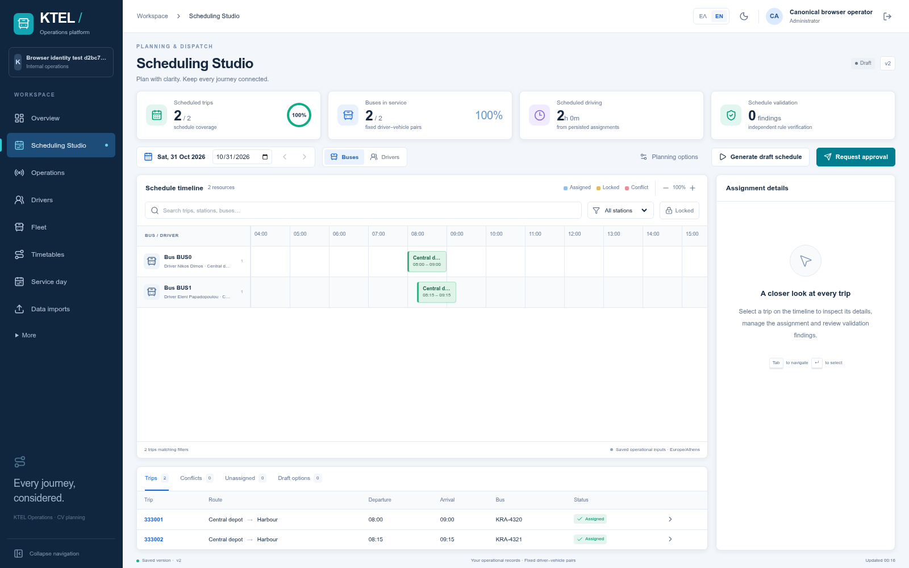
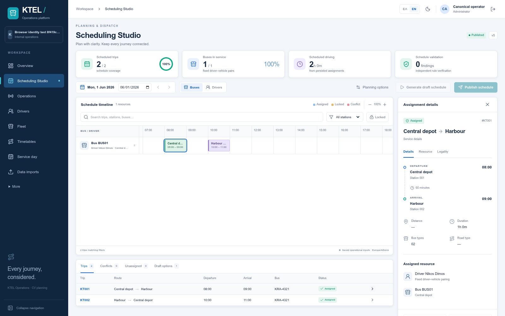
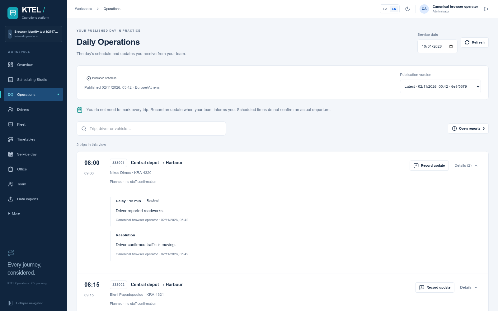
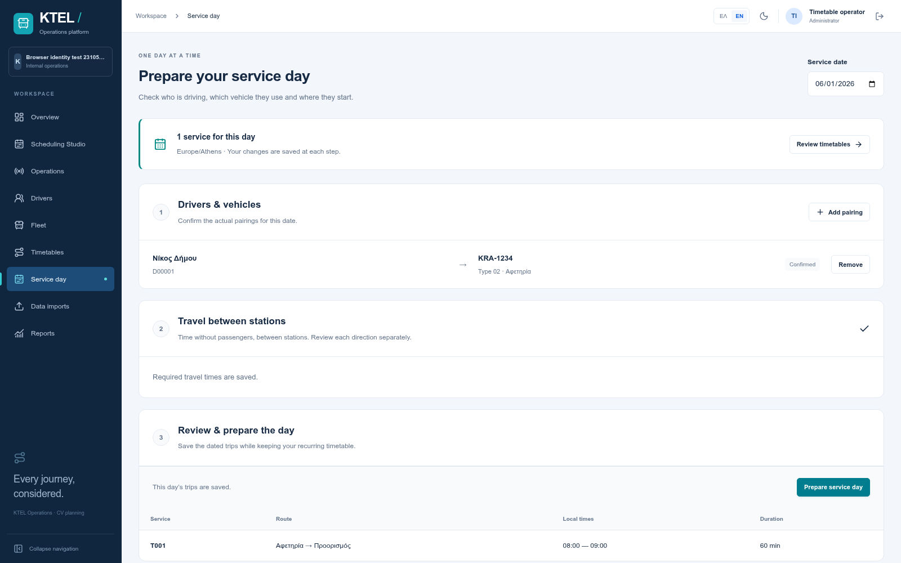
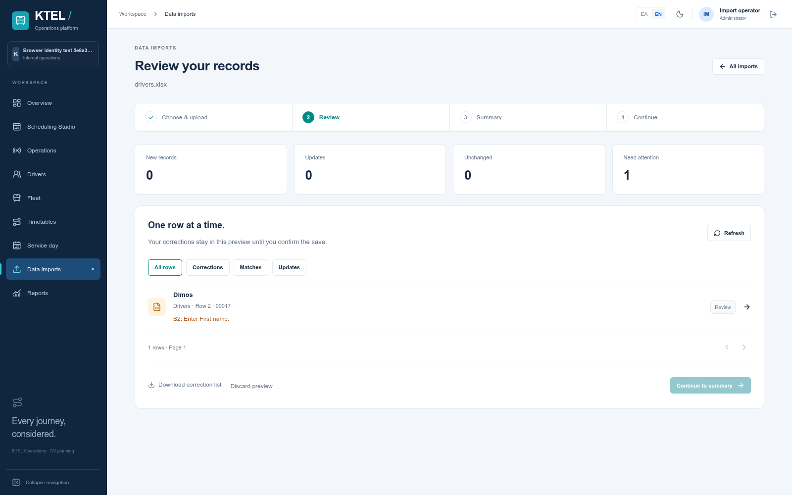
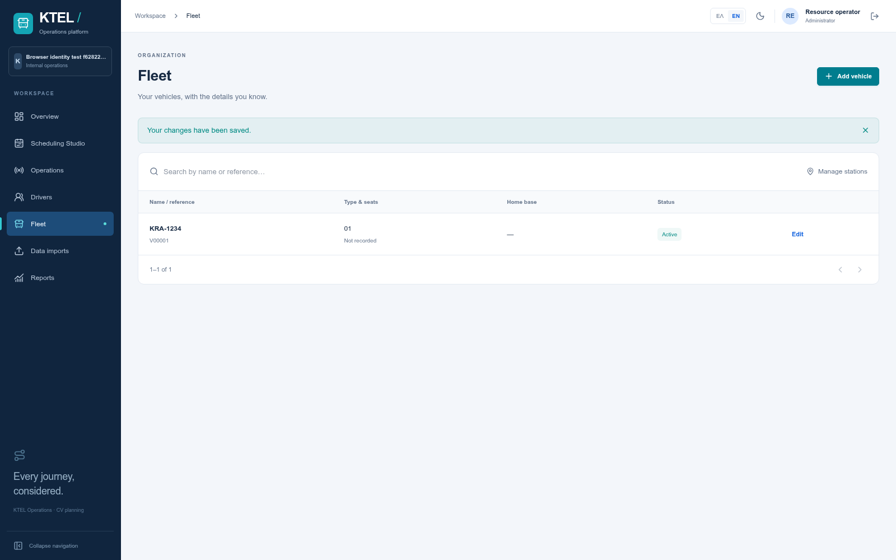
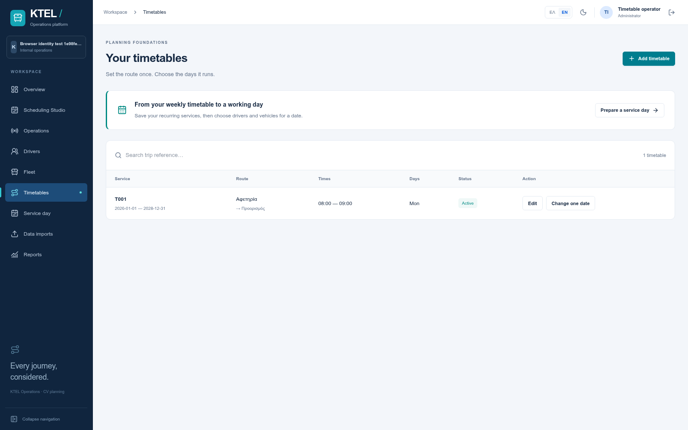
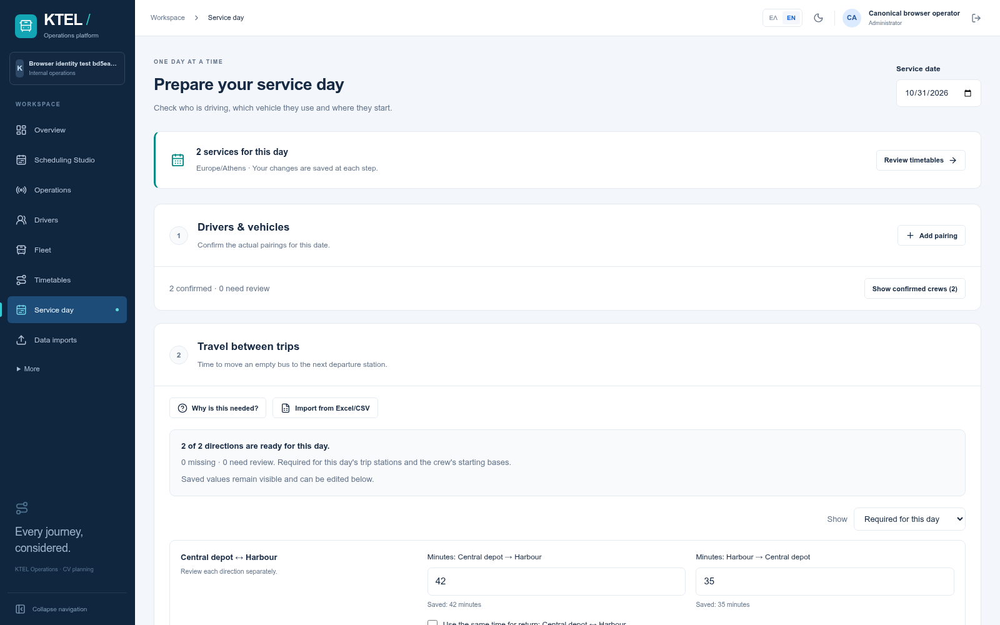
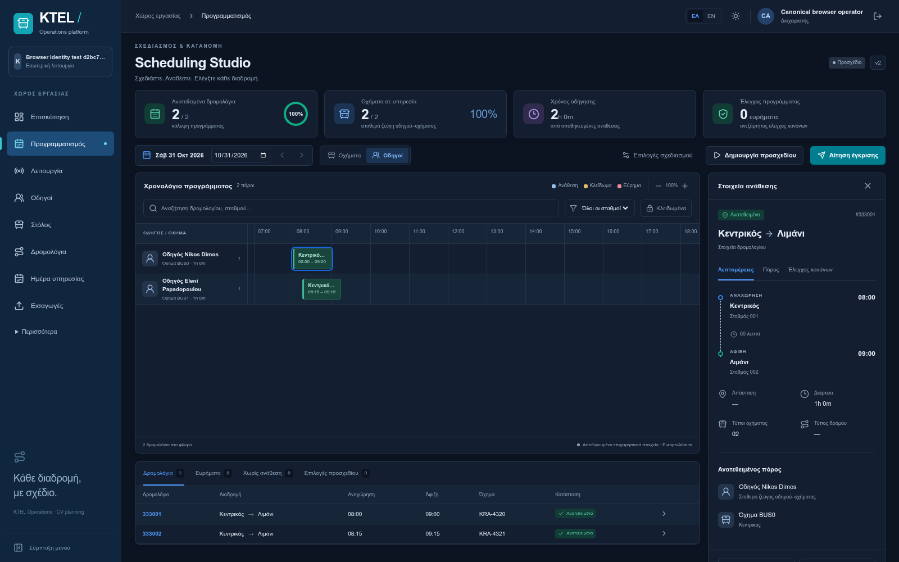
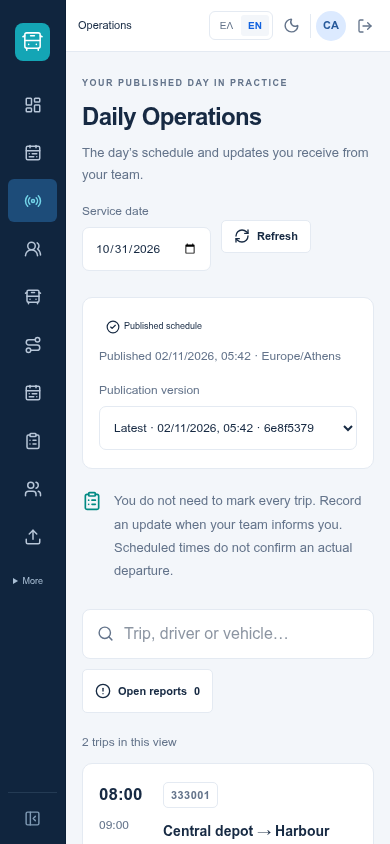

# Optimal Bus Scheduling

## Screenshots

**Scheduling studio**





**Daily operations**




**Spreadsheet imports**



**Resources and timetables**





**Greek UI and mobile**

<p>
  
  
</p>

## Prerequisites

- Docker and Docker Compose installed on your system.

## Installation and Execution

1. Clone the repository:
   ```bash
   git clone https://github.com/GeorgeTzan/optimal-bus-scheduling.git
   cd optimal-bus-scheduling
   ```

2. Create environment files:
   ```bash
   cp backend/.env.example backend/.env
   cp frontend/.env.example frontend/.env
   ```

3. Start the application using Docker Compose:
   ```bash
   docker-compose up --build
   ```

4. Open your browser and navigate to:
   - Frontend: http://localhost:3000
   - Backend API: http://localhost:8000

## Usage

1. Click "Run Solver" to generate the optimal bus schedule
2. View the Gantt chart visualization of bus assignments
3. Click on any trip bar to see trip details
4. Switch between Buses, Trips, and Drivers tabs

## Technologies Used

- Frontend: Next.js, TypeScript, Tailwind CSS, React
- Backend: FastAPI, Python
- Database: PostgreSQL
- Containerization: Docker, Docker Compose